# Main Changes in compare with the original publisher:

The notes below are the user-visible changes in the OpenSCD / CoMPAS publisher, largest first. Copy, remove, and the Add data object / Add data attribute pickers were already in the old version and are left out except where their place in the screen changed.

* A compact layout that keeps more of the SCL on screen
* Create and edit in one dialog
* Sampled Values can be created
* Overviews are grouped by IED and start closed on a large file
* The overview shows the attributes that used to sit in the side editor
* Linking a Data Set, and a lock when another IED subscribes
* Data Set entries are reordered by drag and drop
* Enter saves the open form
* Tooltips explain why an action is blocked
* Overview search waits until typing pauses
* Faster Development - Playground theme bar
* Add LDeviceChooser for GOOSE, Report, or Sampled Value

## 1. A compact layout that keeps more of the SCL on screen

The publisher is restyled as one denser workspace. Data Sets, Reports, GOOSE, and Sample Values sit in a navigation bar with icons. In the old version those four choices were radio buttons, and the default landing page was GOOSE. The bar now opens on Data Sets.

Each page is a left overview and, when a row is open, a detail on the right. Spacing, type, and field height are tighter, so a wide window shows names, paths, and attributes together instead of a single stacked action row. Extra list columns drop away when the overview is narrow, so the name and the connected Data Set stay readable.

Edit forms use the same compact outlined fields, with a lock column so optional values line up. GOOSE, Report, and Sampled Value dialogs are two columns of cards, about 1200 px wide and capped by the viewport. The Data Set dialog is one General card. The dialog title carries the control name and its SCL path. A border keeps that dark bar distinct from the dialog body.

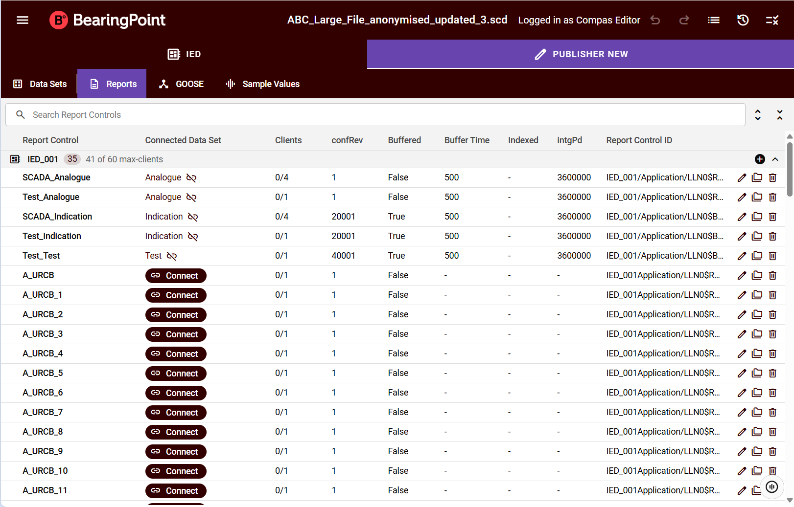

## 2. Create and edit in one dialog

GOOSE, Report, and Sampled Value no longer keep a permanent editor in the right-hand column. The pencil on a row opens that control’s dialog and leaves the detail closed. A row click still opens the connected Data Set.

The plus on an IED no longer writes the SCL immediately. It opens the same dialog, titled for the new control, and the file changes only when Add is pressed. Cancel drops the draft. A click on the page does not close the dialog, and neither does Escape, so an open edit is not discarded. This covers Data Sets, GOOSE, Reports, and Sampled Values. When the IED has more than one LDevice, the plus opens the LDevice dialog in section 12 before that form.

Inside a control dialog, Change data set only stages the choice. Save or Add writes `datSet` in the same edit as the control. Cancel, and a reload of the document, drop the staged Data Set. The Data Set name and description in that dialog are read-only. The Data Set itself is edited on the Data Sets page.

A closed lock means the XML attribute is absent. Opening the lock writes a value; closing it removes the attribute again. Text, checkbox, radio, and select all use that pattern, so a click on a choice enables Save.

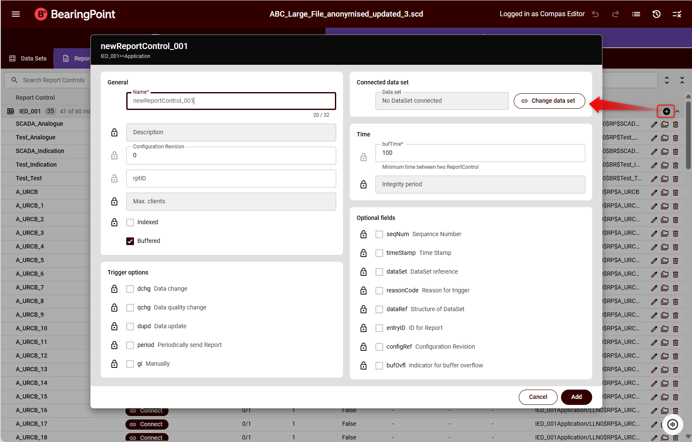

## 3. Sampled Values can be created

In the old version an existing Sampled Value control could be opened or removed. There was no way to add one.

Each IED group now has Add Sampled Value. The dialog covers the control, its sample options, and, when the stream is multicast, the SMV address (MAC, APPID, VLAN). Sample mode is stored as `SmpPerPeriod`, `SmpPerSec`, or `SecPerSmp` and labeled Sampled per Period, Samples per Second, and Seconds per Sample. Security uses the same three labels as GOOSE: None, Signature only, and Signature & encryption.

Multicast stays paired with that address. A missing `multicast` attribute means multicast is on. Unicast (`multicast="false"`) has no SMV address. Turning multicast off in the dialog removes the address on save; turning it back on prepares the address again when the IED has a connection to a SubNetwork. An IED without that connection shows that no connection is available.

The plus stays disabled, with a reason, when the IED has no LN0, no `Services > SMVsc`, or the SMVsc maximum is already filled.

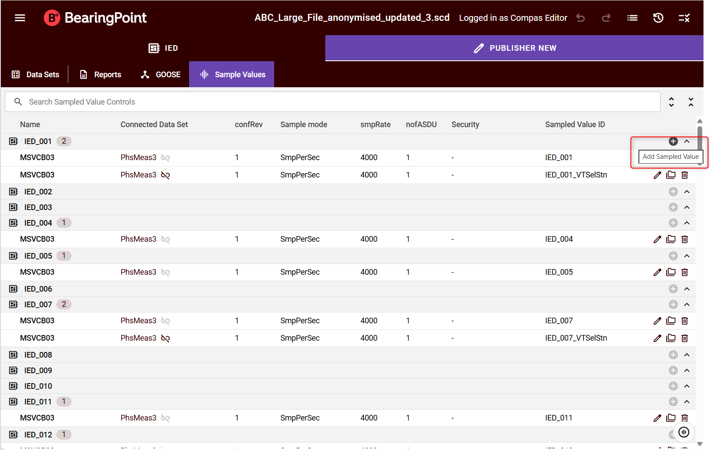

## 4. Overviews are grouped by IED and start closed on a large file

Data Sets, Reports, GOOSE, and Sample Values share one list. Rows are grouped under the IED name, with a count badge, a chevron, and Expand all / Collapse all. A closed group does not build its rows, which is what makes a large file responsive.

When the page has more than 100 rows, every group starts closed. A file with 20 GOOSE controls still opens them. The choice is made on the first paint of that page. Switching to another publisher page mounts a fresh list, so open and closed groups are not remembered across Data Sets, Reports, GOOSE, and Sample Values.

A link from a control to its Data Set opens only that control’s IED when the Data Set page is over the 100-row limit. The other groups stay closed. Creating an entry also opens the IED that received it.

Search shows the matching rows while the query is in the field, including inside groups that are stored as closed. Clearing the search returns to that closed state. The chevron on a group that is only open because of the search does not pin it open. Expand all during a search does pin the groups open.

Expanding one very large IED, or using Expand all on a large page, still renders those rows. That cost is accepted.

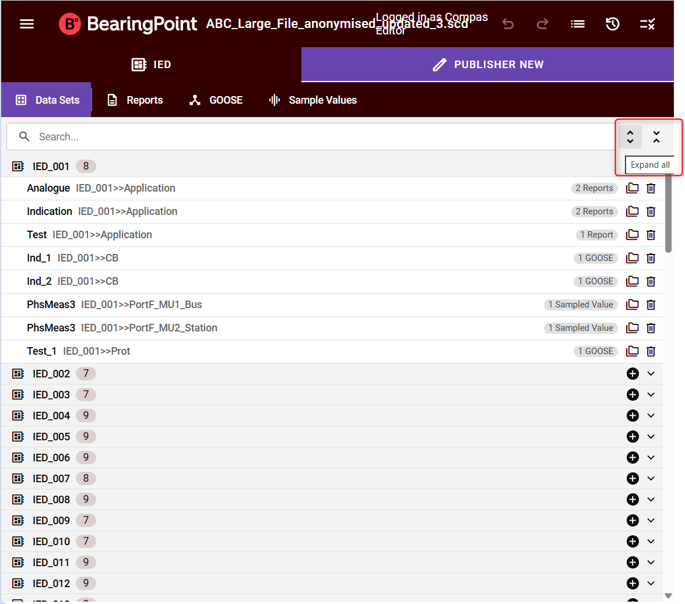

## 5. The overview shows the attributes that used to sit in the side editor

Each control list is a column header plus one row per control. A missing value is a dash. The connected Data Set is a link when the Data Set element exists, a plain name when `datSet` points nowhere, or a Connect button when the control has no Data Set.

| Page | Columns |
| --- | --- |
| Data Sets | Name and SCL path, then chips for how many Report, GOOSE, and Sampled Value controls on the same parent use that Data Set. An unused Data Set is marked Not connected. |
| Reports | Report Control, Connected Data Set, confRev, Buffered, Buffer Time, Indexed, intgPd, Report Control ID |
| GOOSE | Name, Connected Data Set, confRev, Type, Security, Fixed Offset |
| Sample Values | Name, Connected Data Set, confRev, Sample mode, smpRate, nofASDU, Security, Sampled Value ID |

The Report badge is not the number of `ReportControl` elements. It is the sum of `RptEnabled@max` against `ConfReportControl@max`, for example `7/15`. A report with no `RptEnabled` counts as 1. The badge tooltip reads `N ReportControls, X of Y instances`.

On a Data Set, the entries are a table: drag handle, checkbox, Signal, Type, and Path. In the old version the same FCDA was one action row, with the description as supporting text and separate move-up and move-down actions. Signal is `ldInst/prefix+lnClass+lnInst.doName`, plus `.daName` when present. Type is the functional constraint, such as `ST` or `MX`. Path joins the `desc` texts found from the LDevice down to the data attribute. The header shows `n / max Entries` from `ConfDataSet@maxAttributes`. The count stays the full Data Set size while a filter is active. Add data attribute and Add data object sit beside that count and stay disabled when the Data Set cannot take another FCDA.

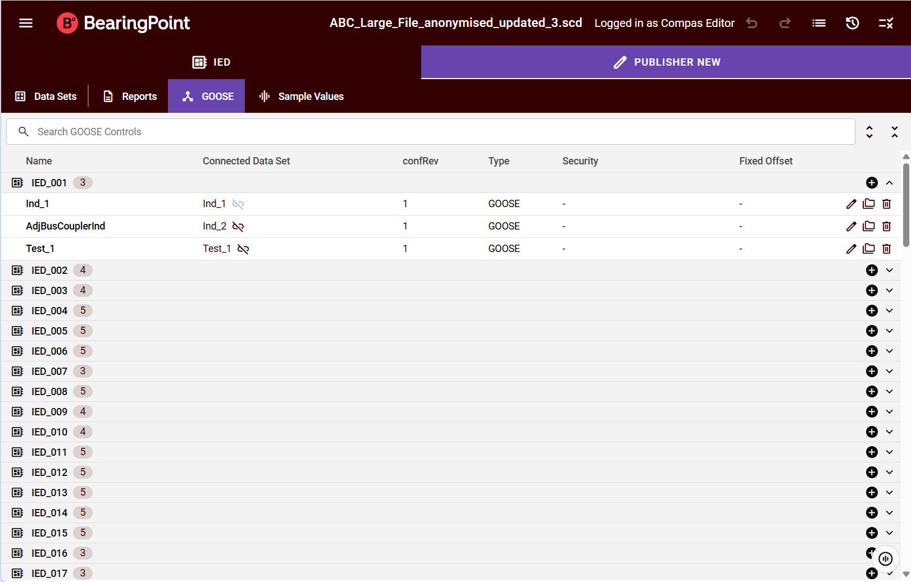

## 6. Linking a Data Set, and a lock when another IED subscribes

Connect on a control row writes `datSet` immediately and leaves the detail closed. The Data Set name in the row jumps to the Data Sets page and selects that Data Set.

Unlink is on the list and on the detail, and only while `datSet` is set. It clears that attribute. The Data Set element and any `ExtRef` subscriptions stay.

When `findControlBlockSubscription` finds a matching `ExtRef`, both unlink and Change data set are disabled. The tooltip is:

- Subscribed by another IED. Cannot unlink or change the data set.

The check matches the control’s IED name, `srcCBName`, service type (Report, GOOSE, or SMV), logical device, prefix, `lnClass`, and `lnInst`.

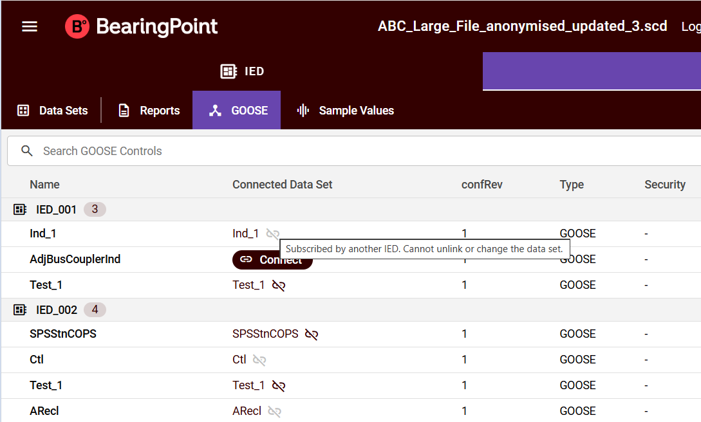

## 7. Data Set entries are reordered by drag and drop

The move-up and move-down buttons are a grip on the row. Dragging moves that one FCDA. A drop on another row inserts before it. A drop after the last visible row inserts after that row. Dropping a row on itself changes nothing. Several checked rows are not moved together.

Visible rows can be selected together. The header checkbox selects the rows the filter currently shows. Delete selected removes those visible checks and shows their count. Checks on rows hidden by the filter remain and come back when the filter is cleared.

Search entries filters Signal, Type, and Path. The entry count next to it does not change with the filter.

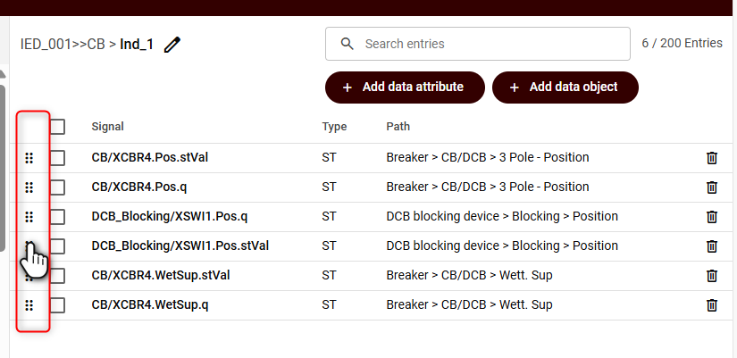

## 8. Enter saves the open form

In the Data Set, Report, GOOSE, and Sampled Value edit dialogs, plain Enter activates the enabled Add or Save changes button. That includes Enter from a text field and from the dialog surface, such as a heading.

Enter is left to the control itself for a select, a checkbox, a radio, the lock, Cancel, and the action buttons. Nothing is saved when Add or Save is disabled, when Shift, Ctrl, Alt, or Meta is held, when the key is repeating, or while an IME composition is open. An unchanged Data Set name leaves the dialog open.

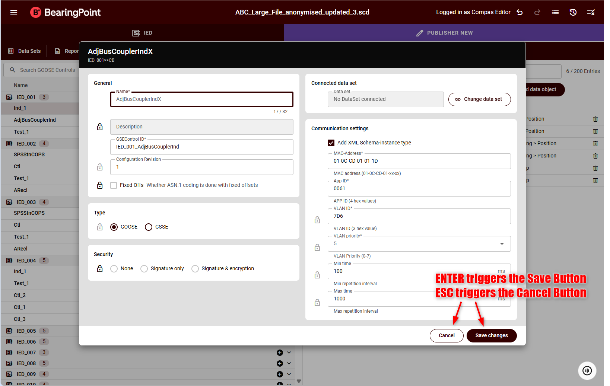

## 9. Tooltips explain why an action is blocked

The IED plus is grey, and does not open the dialog, while the IED cannot take another entry. The tooltip is the first matching reason: missing structure, then a missing Services element, then the maximum. A grey plus does not emit a log event. An enabled plus that the library still refuses logs a warning (`Could not create DataSet`, `Could not create GSEControl`, `Could not create ReportControl`, or `Could not create SampledValueControl`). The LDevice dialog in section 12 uses its own row tooltips. Those row reasons do not replace the plus reasons below.

Data Set:

- This IED has no LDevice.
- This IED has no LN0.
- This LDevice has no LN0.
- Services > ConfDataSet is missing.
- The maximum number of DataSets (N) has been reached.

GOOSE:

- This IED has no LN0.
- Services > GOOSE is missing.
- The maximum number of GOOSE controls (N) has been reached.

Sampled Values:

- This IED has no LN0.
- Services > SMVsc is missing.
- The maximum number of Sampled Value controls (N) has been reached.

Reports, using the instance sum from section 5, including a separate ceiling for buffered reports:

- This IED has no LN0 or LN.
- Services > ConfReportControl is missing.
- The maximum number of report instances (X of Y) has been reached.
- The maximum number of buffered report instances (X of Y) has been reached.

Row actions name themselves on hover: Edit DataSet, Edit Report, Edit GSEControl, Edit Sampled Value, Add DataSet, Copy, and Remove. Group headers use Expand, Collapse, Expand all, and Collapse all. A disabled button keeps its tooltip on a wrapper, because the button itself does not show one while it is disabled.

Fields add a short supporting line where the value is easy to misread. Examples:

- MAC address (01-0C-CD-01-xx-xx) for GOOSE, and 01-0C-CD-04-xx-xx for Sampled Values
- APP ID (4 hex values) for GOOSE, and APP ID (4xxx in hex) for Sampled Values
- Whether ASN.1 coding is done with fixed offsets
- Minimum time between two ReportControl
- Whether Sample Value Stream is multicast
- Sample mode (Samples per Second, Sampled per Period, Seconds per Sample)
- Number of Samples per Ethernet packet

The lock column uses Enable or Clear plus the field label.

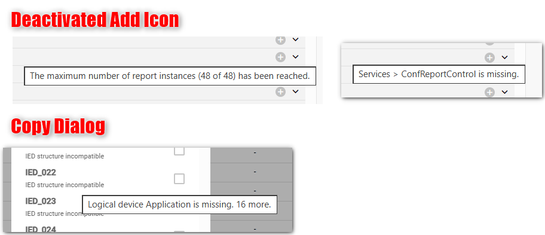

## 10. Overview search waits until typing pauses

The overview filter used to run on every key. The field still shows the typed text immediately. The row filter, and the search value remembered for that page, update 200 ms after the last key. Another key restarts the wait. The same 200 ms pause is used before the dialog title follows the name field.

A search value set from outside the field, including the text restored when returning to a page, applies at once. The filter matches the control or Data Set name and its SCL path. A query that matches an IED name shows that whole group.

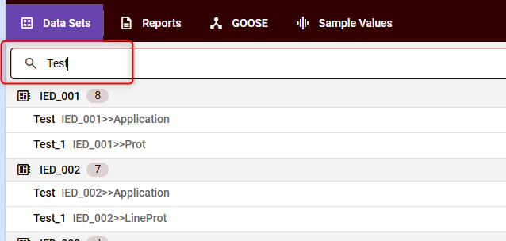

## 11. Faster Development - Playground theme bar

The standalone playground keeps its document and theme controls in a top bar and can switch host presets, including the navigation colors the new publisher bar uses. Log events from the host are written to the browser console. The production plugin does not load this bar. In OpenSCD or CoMPAS the host still supplies the theme tokens and the fonts.

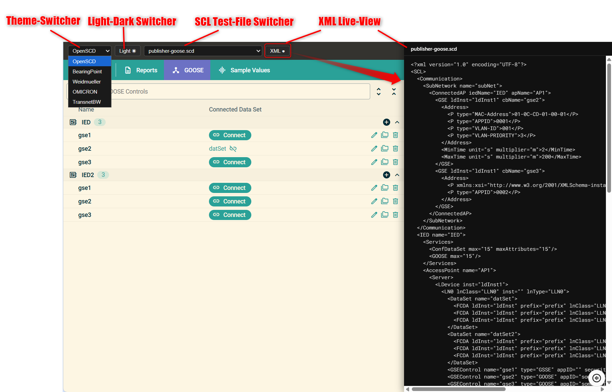

## 12. Add LDeviceChooser for GOOSE, Report, or Sampled Value

In the old version, the plus asked which LDevice receives a new Data Set when the IED has more than one. That dialog now opens for a new GOOSE, Report, or Sampled Value as well. One LDevice still skips it and opens the create form. The list shows each `inst` under the title Select LDevice. Select continues into the create dialog. Cancel writes nothing.

The control is created on the LN0 of the chosen LDevice. A Report uses the first LN0 or LN there, and a GOOSE or SMV address follows that LDevice. A row stays disabled when it cannot take the entry: a Data Set without LN0, without `ConfDataSet`, or at its maximum; a GOOSE or Sampled Value without LN0; a Report with neither LN0 nor LN. The GOOSE, Report, and Sampled Value maximum stays on the IED plus.

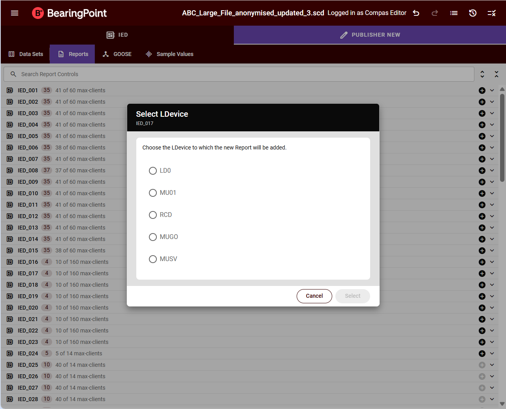
